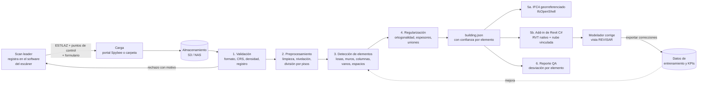
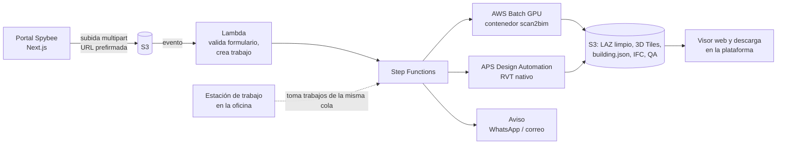

# Pipeline Scan-to-BIM de Spybee: de la nube de puntos a un Revit georreferenciado

*Propuesta técnica — noviembre de 2026. Complementa el reporte `reports/Automatización Scan to BIM en Spybee.md`.*

## 1. Qué queremos lograr

**Entrada:** lo que hoy entrega el scan leader, es decir, la nube registrada, los puntos de control y unos pocos datos del proyecto.

**Salida automática:**
- un modelo Revit (RVT) nativo y georreferenciado, con la nube vinculada;
- un IFC4 georreferenciado;
- un reporte de calidad que marca qué elementos se pueden aprobar y cuáles hay que revisar.

**Regla 80/20:** la máquina modela todo lo que puede y asigna a cada elemento una confianza. Lo dudoso queda marcado en rojo dentro de Revit, y el modelador de operaciones solo corrige eso. No es un BIM con toda la información; es la **geometría as-built de lo que se escaneó**, con tipos genéricos, lista para que el equipo la complete si el proyecto lo pide.

| Entra en la versión 1 (arquitectura y estructura, LOD 200) | Queda para después |
|---|---|
| Niveles y cotas de piso | Vigas y escaleras (versión 2) |
| Losas, con su contorno y espesor | Muros curvos y muros cortina |
| Muros rectos, también los no ortogonales, con su espesor | MEP. Mientras tanto se usa EdgeWise o Aurivus como apoyo |
| Columnas rectangulares y circulares | Elementos ocultos (dentro de muros, sobre cielos rasos) |
| Vanos rectangulares: puertas y ventanas como familias genéricas | Familias y tipos específicos de cada cliente (LOD 300) |
| Espacios, con su área | |

**¿Es realista el 80/20?** Sí, para muros, losas, niveles y columnas en edificios de geometría regular, que es lo típico en vivienda y oficinas en Colombia. Los vanos y los elementos irregulares son justamente los que caen en el 20 %. Hay que medirlo en **horas humanas** y no solo en número de elementos: el 20 % de elementos difíciles puede comerse la mitad del tiempo de corrección. La sección 9 explica cómo medirlo.

---

## 2. El flujo de punta a punta



| Etapa | Qué hace | Herramientas | Lenguaje | Tiempo estimado para 5.000 m²* |
|---|---|---|---|---|
| 1. Validación | Revisa formato, sistema de coordenadas, unidades, densidad de puntos, cobertura por piso y el informe de registro. Rechaza la entrega con un motivo claro si no cumple. | PDAL, laspy, pye57 | Python | 5–15 min |
| 2. Preprocesamiento | Quita ruido, submuestrea a 1–2 cm para detectar (sin borrar la nube original), calcula normales, nivela con z hacia arriba, detecta las direcciones dominantes y divide por pisos con un histograma de alturas. | PDAL, Open3D, NumPy | Python | 10–30 min |
| 3. Detección | Busca planos y cortes 2D por piso y extrae losas, muros, columnas, vanos y espacios. En la versión 1 es geométrica; la IA entra después (sección 4). | Open3D, NumPy/SciPy, Shapely, scikit-learn; luego PyTorch con Pointcept | Python | 10–40 min |
| 4. Regularización | Lleva a 90° lo que está casi a 90°, alinea muros colineales, redondea espesores al catálogo y cierra uniones. | Shapely, NumPy | Python | 1–5 min |
| 5a. IFC | Escribe el IFC4 con georreferencia y un set de propiedades de Spybee. | IfcOpenShell | Python | < 1 min |
| 5b. Revit | Crea niveles, muros, losas, columnas, puertas, ventanas y espacios nativos, y además fija las coordenadas compartidas, vincula la nube y marca lo que hay que revisar. | Revit API | C# (.NET) | 2–10 min |
| 6. Reporte QA | Calcula la distancia nube–modelo por elemento, arma un mapa de calor y compara con los puntos de control. | Open3D, HTML/PDF | Python | 5–15 min |
| **Total de cómputo** | | | | **~30–90 min** |
| Corrección humana | El modelador revisa lo que quedó en rojo. | Revit | — | **Meta: 4–12 h** para LOD 200 de arquitectura y estructura |

\* Son estimaciones de diseño, no mediciones. Como referencia, Cloud2BIM, un pipeline abierto parecido, reporta unos 60 s por edificio de prueba. Los tiempos reales se miden con los primeros proyectos.

---

## 3. El contrato de entrega del scan leader

Para que el proceso sea "pasar la nube y listo", la entrada tiene que llegar estandarizada. Este es el acuerdo mínimo con el equipo de campo; la etapa 1 lo verifica sola.

| Campo | Requisito |
|---|---|
| Formato | E57, o LAZ 1.4, con color e intensidad. Siempre se conserva también la nube original sin diezmar. |
| Registro | Nube ya registrada en el software del escáner. Se adjunta el informe de registro, con RMS ≤ 10 mm como meta inicial. |
| Coordenadas | Origen Nacional CTM12 (**EPSG:9377**, el sistema oficial del IGAC desde la Resolución 471 de 2020). Si la nube viene en un sistema local, se adjunta la matriz de transformación. Hay que declarar si las cotas son ortométricas o elipsoidales. |
| Unidades y orientación | Metros, con el eje z hacia arriba y la nube nivelada. |
| Puntos de control | CSV con `id, este, norte, cota, método, precisión`, medidos con estación total o GNSS. Mínimo 3 por piso, y que no queden todos en línea. |
| Cobertura | Todos los espacios recorridos, las dos caras de los muros interiores siempre que se pueda y los lazos del SLAM cerrados. |
| Formulario | Proyecto, dirección, número de pisos, uso, estado (obra gris, en acabados u ocupado), LOD pedido, escáner y modo usados, fecha. |
| Nombre de archivos | `PRJ-<id>_<edificio>_<AAAAMMDD>_<escaner>.e57` |

Con esto se evita que el modelo falle por culpa de la entrada: si la nube viene mal registrada, el sistema la rechaza en minutos y no después de una semana.

---

## 4. Cómo se convierte la nube en elementos

La versión 1 es **geométrica**: no necesita entrenar IA y funciona desde el primer proyecto. La IA se suma cuando ya existan datos propios, sobre todo para manejar el desorden típico de obra (andamios, material, personas).

**Losas y niveles**
- Se busca en el histograma de alturas de los puntos con normal vertical.
- Cada pico es un piso o un cielo raso.
- El contorno de la losa sale de un *alpha shape* o casco cóncavo de esos puntos.
- El espesor es la distancia entre la cara superior de una losa y la cara inferior vista desde el piso de abajo. Si hay cielo raso falso, la losa queda marcada para revisar.

**Muros** (es el corazón del sistema)
1. Por cada piso se toma una franja horizontal entre 1,0 y 1,5 m sobre el piso terminado. Queda por encima del mobiliario y por debajo de los cielos rasos.
2. Se proyecta en 2D y se rasteriza a 1–2 cm.
3. Se extraen segmentos de línea con RANSAC o Hough, que también encuentran muros no ortogonales.
4. Se emparejan caras paralelas y opuestas separadas entre 5 y 40 cm. El eje del muro queda al medio y el espesor es la separación entre las caras.
5. Se confirma que el muro es continuo en altura usando todos los puntos de ese plano.
6. Si solo se escaneó una cara, por ejemplo un muro de fachada sin escaneo exterior, se asume el espesor estándar del catálogo y el muro queda marcado para revisar.

**Columnas**
- Son contornos pequeños y cerrados en el corte 2D, a los que se ajusta un rectángulo o un círculo.
- En obra gris con pórticos de concreto y mampostería, una columna embebida en el muro es casi coplanar con él. Ahí ayuda el color o la intensidad (concreto frente a ladrillo), y es uno de los primeros casos donde la IA aporta.

**Vanos (puertas y ventanas)**
- Los puntos de cada muro se proyectan sobre su propio plano, en coordenadas a lo largo del muro × altura.
- Se buscan rectángulos vacíos.
- Si el antepecho es 0 se clasifica como puerta; si es mayor a ~0,6 m, como ventana.
- En obra gris no hay hojas instaladas, así que se modelan como vanos o familias genéricas.
- Su confianza suele ser menor: son buena parte del 20 % a revisar.

**Espacios**
- Se forman con los polígonos cerrados que dejan los muros en cada piso.
- En Revit se crean como recintos a partir de los muros, así que el área sale sola.

**Confianza por elemento:** se combina en un número de 0 a 1 a partir de:
- la cobertura de puntos: qué parte de la superficie se ve en la nube;
- el residuo del ajuste: la desviación RMS;
- la coherencia entre franjas de altura;
- más adelante, la probabilidad que asigne el modelo de IA.

Si la confianza queda por debajo del umbral, el elemento va a `estado = "revisar"`.

**Cuándo entra la IA:** con 20–50 pares nube + modelo manual, la nube se etiqueta automáticamente transfiriendo la clase del elemento BIM más cercano. Con eso se entrena un segmentador basado en el código de Pointcept o LitePT, que tiene licencia MIT. Los pesos tienen que ser propios, porque los mejores pesos públicos no permiten uso comercial. El segmentador limpia el desorden **antes** del paso geométrico, así que no reemplaza la geometría sino que le entrega puntos más limpios.

---

## 5. El formato intermedio: `building.json`

Todo el procesamiento termina en un JSON neutro. Tanto el IFC como el Revit se generan desde ese archivo, y así cada parte del pipeline se puede probar por separado. Las llaves van en inglés por convención de código; la tabla de abajo explica las principales en español.

```json
{
  "schema": "spybee.building/0.1",
  "project": { "id": "PRJ-0123", "name": "Torre Norte", "capture_date": "2026-10-28", "scanner": "XGRIDS L2 Pro" },
  "georef": {
    "crs": "EPSG:9377",
    "offset": { "easting": 4880000.0, "northing": 2070000.0, "elevation": 2600.0 },
    "true_north_deg": 12.4,
    "vertical_datum": "orthometric"
  },
  "levels": [
    { "id": "L1", "name": "Piso 1", "elevation": 0.0 },
    { "id": "L2", "name": "Piso 2", "elevation": 2.60 }
  ],
  "walls": [
    {
      "id": "W-0001", "base_level": "L1", "top_level": "L2",
      "axis": [[12.403, 5.210], [18.950, 5.212]],
      "thickness": 0.15, "height": 2.45,
      "material_guess": "masonry",
      "confidence": 0.93, "rms_mm": 6.1, "coverage": 0.81,
      "status": "auto"
    }
  ],
  "openings": [
    { "id": "O-0001", "host": "W-0001", "kind": "door", "offset_along": 2.10,
      "width": 0.90, "height": 2.10, "sill": 0.0,
      "confidence": 0.71, "status": "review" }
  ],
  "slabs":   [ { "id": "S-0001", "level": "L2", "outline": [[0,0],[24.5,0],[24.5,18.2],[0,18.2]], "thickness": 0.12, "confidence": 0.95, "status": "auto" } ],
  "columns": [ { "id": "C-0001", "base_level": "L1", "top_level": "L2", "center": [6.0, 4.0], "shape": "rect", "size": [0.30, 0.50], "rotation_deg": 0, "confidence": 0.84, "status": "auto" } ],
  "spaces":  [ { "id": "R-0001", "level": "L1", "seed": [8.2, 7.5], "name_guess": null } ]
}
```

| Llave | Significado |
|---|---|
| `georef.offset` | Origen redondo que se le resta a las coordenadas CTM12. Todo lo demás está en metros locales a partir de ese punto. |
| `true_north_deg` | Rotación entre el norte del proyecto y el norte real. |
| `axis` | Eje del muro en 2D, en coordenadas locales. |
| `confidence` / `status` | Confianza de 0 a 1. `auto` significa aprobado por la máquina; `review` significa que va a la vista REVISAR. |
| `rms_mm` / `coverage` | Desviación del ajuste y fracción de la superficie con puntos. |

---

## 6. Cómo se genera el Revit

**Por qué no basta con abrir el IFC en Revit:** al importarlo, Revit crea elementos poco editables, muchas veces formas directas (DirectShape) en vez de muros o losas de verdad. Para que el modelador corrija con comodidad hacen falta **elementos nativos**, y eso se logra con un add-in propio.

**Add-in de Revit "Spybee Scan2BIM"**, en C# sobre la Revit API:

| Comando | Qué hace |
|---|---|
| Generar modelo | Lee `building.json`, abre la plantilla de Spybee (`.rte`, con sus tipos de muro, losa y familias genéricas) y crea niveles, muros, losas, columnas, puertas, ventanas y recintos. También fija las coordenadas compartidas y vincula la nube. |
| Panel Revisar | Muestra la lista de elementos con `status = review`, ordenada de menor a mayor confianza. Con un clic hace zoom al elemento y con otro lo marca como corregido. |
| Exportar correcciones | Compara el modelo corregido contra el JSON original usando el identificador de Spybee de cada elemento y genera `corrections.json` con lo creado, lo borrado y lo modificado. Ese archivo alimenta los KPI y el entrenamiento. |

**Detalles de implementación:**
- **Unidades:** Revit trabaja internamente en **pies**. Todo valor en metros se convierte con `UnitUtils.ConvertToInternalUnits(valor, UnitTypeId.Meters)`. Es el error más común.
- **Muros:** `Wall.Create(doc, línea, tipoMuro, nivel, altura, desfase, flip, estructural)`. Si no hay un tipo con ese espesor, se duplica uno base y se ajusta el ancho de su `CompoundStructure`, por ejemplo "Muro genérico 15 cm".
- **Losas:** `Floor.Create(doc, contornos, tipoLosa, nivel)`, disponible desde Revit 2022.
- **Puertas y ventanas:** `NewFamilyInstance(punto, tipo, muroAnfitrión, nivel, NonStructural)`, con tipos duplicados por ancho × alto.
- **Recintos:** `NewRoom(nivel, punto)`, después de crear los muros.
- **Parámetros compartidos:** `Spybee_Id`, `Spybee_Confianza`, `Spybee_Desviacion_mm` y `Spybee_Estado` (Auto, Revisar o Corregido).
- **Vistas:**
  - una planta por nivel, un 3D y una vista **"00_REVISAR"**;
  - un filtro pinta en rojo lo que tiene `Spybee_Estado = Revisar` y en verde lo que está aprobado;
  - la nube vinculada se superpone a todas las vistas.
- **Nube vinculada:** `PointCloudType.Create(doc, "rcp", ruta)` y `PointCloudInstance.Create(...)`. Revit también puede indexar formatos crudos como E57 al insertarlos; si no, el scan leader exporta a RCP con ReCap.
- **Código separado de la interfaz:** la lógica que crea elementos va en una librería sin UI (`Spybee.Scan2BIM.Core`). Así el mismo código se empaqueta después para **APS Design Automation**, el Revit sin interfaz que Autodesk corre en la nube, y el RVT se genera sin que nadie abra Revit.
- **Versión de Revit:** desde Revit 2025 los add-ins se compilan para .NET 8; hasta 2024, para .NET Framework 4.8. Hay que fijar desde el inicio la versión que usa operaciones.

---

## 7. Georreferenciación

1. **Lectura:** la nube llega en CTM12 (EPSG:9377). Las coordenadas son del orden de millones de metros, así que se leen en doble precisión (float64).
2. **Trabajo local:** se resta un origen redondo cercano al edificio, el `offset`, y todo el procesamiento se hace en metros locales. Así se evitan problemas de precisión numérica.
3. **Revit:**
   - El modelo se construye cerca del **origen interno**, porque Revit pierde precisión con geometría a más de ~32 km de él.
   - La georreferencia se guarda en las **coordenadas compartidas**: el punto de reconocimiento (Survey Point) queda en el `offset` y el ángulo al norte real en `true_north_deg`, a través de `ProjectLocation.SetProjectPosition`.
   - Con eso, el modelo se puede vincular sin moverlo con planos de diseño, topografía y modelos del cliente en ACC.
4. **IFC:** se escriben `IfcMapConversion` (este, norte, cota ortométrica y rotación) e `IfcProjectedCRS` con `EPSG:9377`, usando el módulo de georreferencia de IfcOpenShell.
5. **Verificación automática:** los puntos de control se transforman al sistema local y se comparan contra la nube. Si alguno difiere más que la tolerancia (por ejemplo, 2 cm), el reporte QA lo marca.

Lo topográfico (el geoide, la cota ortométrica frente a la elipsoidal) lo resuelve el scan leader o el equipo de topografía al entregar la nube. El pipeline solo exige que venga declarado.

---

## 8. Lenguajes, infraestructura y si hace falta una Lambda

### Lenguajes

| Parte | Lenguaje | Por qué |
|---|---|---|
| Procesamiento de nubes, geometría, IA, IFC | **Python 3.11+** | Ahí están PDAL, Open3D, PyTorch, Pointcept e IfcOpenShell |
| Add-in de Revit y Design Automation | **C# (.NET 8)** | La Revit API es .NET |
| Portal de carga, estado de trabajos y visor web | **TypeScript (Next.js/React)** | Es el stack que ya usa Spybee. El visor de nubes puede ser Potree o 3D Tiles; el de IFC, That Open Engine (web-ifc) |
| Infraestructura | Docker + Terraform o AWS CDK | El mismo contenedor corre en la estación de trabajo y en la nube |

No hace falta C++ ni Rust al inicio: las librerías de Python ya tienen núcleos en C++.

### ¿Lambda? ¿Computador dedicado? ¿Nube?

| Opción | Sirve para | No sirve para | Costo aproximado | Veredicto |
|---|---|---|---|---|
| **AWS Lambda** | Pegamento: cuando llega un archivo, validar el formulario, crear el trabajo, avisar por WhatsApp o correo | **Procesar nubes**: máximo 15 min por ejecución, 10 GB de RAM, 10 GB de disco temporal y sin GPU | Centavos | Solo como disparador |
| **Estación de trabajo dedicada** (en la oficina) | Desarrollo, procesamiento en el MVP, Revit con el add-in, entrenamiento ligero de IA | Muchos proyectos en paralelo; acceso desde fuera | US$6.000–10.000 una sola vez, más IVA y arancel si se importa | **Recomendada para arrancar** |
| **Nube con GPU** (AWS Batch o ECS sobre instancias g6 o g5) | Producción escalable, varios proyectos a la vez, sin mantener hardware | Hay que subir decenas de GB; costo variable | ~US$1–2 por hora de instancia con GPU y 64–128 GB de RAM (precio bajo demanda; hay que verificarlo) | Fase 2 |
| **APS Design Automation** (Revit en la nube) | Generar el RVT sin abrir Revit, como parte del flujo automático | Depurar es más difícil | Se paga en Flex tokens, ~2 por hora de proceso | Fase 2 |

**Recomendación:** arrancar con **una estación de trabajo dedicada** y todo empaquetado en Docker desde el primer día. Cuando el volumen crezca, ese mismo contenedor pasa a AWS Batch, y la estación queda como un trabajador más de la misma cola.

**Estación de trabajo sugerida** (precios a cotizar):
- **CPU:** 16–24 núcleos (Ryzen 9 9950X, Threadripper o Xeon W).
- **RAM:** 128 GB como mínimo; 256 GB es lo ideal, porque las nubes se cargan en memoria.
- **GPU:** NVIDIA con 24–32 GB de VRAM (RTX 4090 o RTX 5090). Sirve para la inferencia y para entrenar.
- **Disco:** 2 × 4 TB NVMe para trabajar, más un NAS o S3 para el archivo histórico.
- **Sistema operativo:** Windows 11 Pro, con Revit nativo y el pipeline de Python en WSL2 + Docker con GPU.

**Subida a la nube (a tener en cuenta):**
- 20 GB tardan ~27 min a 100 Mbps y ~9 min a 300 Mbps.
- 100 GB tardan ~2,2 h a 100 Mbps.
- Para la detección basta una nube a 1 cm. La nube completa se archiva aparte, sin apuro.

### Arquitectura en la nube (fase 2)



AWS no tiene región en Colombia. Para procesos por lotes, us-east-1 suele ser lo más barato, porque la latencia no importa.

---

## 9. Cómo sabemos si llegamos al 80 %

El trabajo de modelado de los proyectos anteriores es la vara de medir. Con los **pares nube + RVT manual** se arma un evaluador automático que corre en cada cambio del código:

| Métrica | Cómo se mide | Meta del MVP |
|---|---|---|
| Precisión y exhaustividad por clase | Se emparejan los elementos automáticos con los manuales. Un muro empareja si su eje está a menos de 10 cm y se superpone más del 50 %. | Muros y losas ≥ 95 %, columnas ≥ 90 %, vanos ≥ 80 % |
| Error geométrico | Diferencia de posición y de espesor entre el muro automático y el manual | Mediana ≤ 2 cm en posición; espesor dentro del catálogo |
| **Tasa de corrección** | Porcentaje de elementos que el modelador crea, borra o edita (sale de `corrections.json`) | **≤ 20 %** |
| **Horas humanas por cada 1.000 m²** | Tiempo de revisión registrado | ≤ 2,5 h para LOD 200 de arquitectura y estructura, coherente con 4–12 h para 5.000 m² (por calibrar) |
| Captura → RVT revisado | Horas de calendario | ≤ 48 h |
| Desviación nube–modelo | Porcentaje de elementos dentro de la tolerancia | ≥ 90 % de muros y losas dentro de LOA20 |

Si la tasa de corrección baja pero las horas no, los elementos que fallan son los caros. Eso indica dónde invertir la siguiente iteración.

---

## 10. Plan de trabajo del MVP (~14 semanas)

**Equipo mínimo:**
- un ingeniero de geometría 3D y nubes de puntos en Python, que es el núcleo;
- un desarrollador C# con experiencia en la Revit API (puede ser a medio tiempo o contratista);
- un modelador BIM senior de operaciones, que define la plantilla, revisa y mide.

El equipo de plataforma se suma para el portal de carga. Un perfil de IA entra desde el mes 4.

| Semanas | Entregable |
|---|---|
| 1–2 | Contrato de entrega firmado con el scan leader; 5–10 pares reunidos; repositorio, Docker y estación de trabajo listos; `building.json` v0.1; plantilla Revit de Spybee |
| 3–4 | Validación, preprocesamiento, niveles y losas. El add-in crea niveles y losas georreferenciados. **Primer edificio de punta a punta**, aunque sea solo con losas |
| 5–7 | Muros, con espesores y uniones, y columnas. Evaluador automático contra los modelos manuales |
| 8–10 | Vanos, espacios, confianza, vista REVISAR, reporte QA e IFC4 |
| 11–14 | **Piloto con operaciones en 3 proyectos reales**: medir horas y tasa de corrección, y exportar las correcciones |
| Después | Segmentación con IA entrenada con los pares, para el desorden de obra; portal de carga en la plataforma; paso a la nube con Batch y Design Automation; vigas y escaleras; MEP asistido; comparación de avance escaneo vs BIM |

## 11. Costos frente a pagarle a terceros

| Concepto | Valor de referencia |
|---|---|
| Modelado tercerizado LOD 200, solo modelado | ~US$1,6–2,7/m² según tarifas publicadas por proveedores internacionales. Para 5.000 m²: **US$8.000–13.500** |
| Modelado tercerizado LOD 300 | ~US$2,7–4,8/m². Para 5.000 m²: **US$13.500–24.000** |
| Estación de trabajo | US$6.000–10.000 una sola vez |
| Cómputo en la nube por edificio | Del orden de US$1–5 (estimación; hay que medirlo) |
| Licencias | Revit ya lo tienen; Design Automation se paga por uso en la fase 2 |

El hardware se paga con el primer proyecto que no se terceriza. El costo de verdad es el tiempo de las 2–3 personas del equipo, y eso es lo que el piloto de la semana 11 tiene que justificar con horas medidas.

## 12. Limitaciones

- **Lo que no se ve en la nube no se modela.** Esto incluye lo que hay dentro de los muros y sobre los cielos rasos.
- **Obra en curso:** andamios, material y personas meten ruido. El corte a 1,0–1,5 m ayuda, pero la IA entrenada con datos propios es la solución de fondo.
- **Vidrio y superficies reflectivas** dejan huecos en la nube, y las fachadas acristaladas salen incompletas.
- **La calidad de la entrada manda.** Una nube mal registrada produce un modelo malo. Por eso existen el contrato de entrega y la validación automática.
- **MEP** no entra en la versión 1. Mientras tanto, EdgeWise (desde US$1.995 al año) acelera la tubería dentro de Revit.

## 13. Qué necesitamos de ustedes para arrancar

1. **De 3 a 5 proyectos con nube registrada y su RVT hecho a mano.** Que haya tipos distintos: obra gris, edificio terminado, vivienda y oficinas. Las nubes van en S3, Drive o un NAS, no en Git. En Git va un manifiesto JSON por proyecto, con los metadatos de la sección 3.
2. **Qué entrega hoy el scan leader:** el escáner, el software de registro, el formato y el sistema de coordenadas que usa.
3. **La versión de Revit** que usa operaciones y su plantilla o estándar actual: tipos de muro, familias y nombres de niveles.
4. **La nube que usa Spybee** (¿AWS?) y la velocidad de subida del internet de la oficina.
5. **Qué piden más los clientes:** qué elementos y qué LOD, para ordenar las prioridades después de muros y losas.
