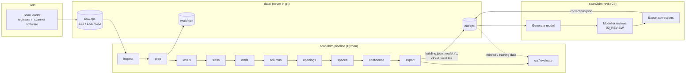

# System architecture

## Overview

## Responsibilities

| Component | Owns | Does not do |
|---|---|---|
| `scan2bim-pipeline` | Reading clouds, all geometry/detection, confidence, building.json (contract), IFC, QA, evaluation, the program plan and docs | Anything inside Revit |
| `scan2bim-revit` | Translating building.json into native Revit elements, review marking/views, shared coordinates, exporting corrections | Point cloud processing (Revit API is capped at 1 M points per call) |
| `building.json` | The only interface between the two | — |
| `data/` | Inputs, intermediates, outputs (local disk; backed up outside git) | — |

## Stage contract (pipeline)

Each stage: `run_<stage>(paths, cfg, meta) -> Result`; reads `work/`, writes `work/<stage>.json` (or binary
intermediates) and `out/debug/<stage>/*.png`; logs counts, time and peak RAM; is skipped when its outputs are
newer than its inputs unless `--force` (planned with `run-all`).

| Stage | Input | Output |
|---|---|---|
| inspect | raw | out/cloud_report.md/json, debug/inspect |
| prep | raw | work/cloud_work.laz, normals.npz, georef.json |
| levels | cloud_work + normals | work/levels.json, work/floors/F0X.laz |
| slabs | floors, levels | work/slabs.json |
| walls | floors, levels | work/walls.json |
| columns / openings / spaces | floors, walls | work/*.json |
| confidence | all element JSONs | updated element JSONs |
| export | element JSONs, georef | out/building.json, model.ifc, cloud_local.las |
| qa | building.json + cloud | out/qa.html |
| evaluate | building.json + reference | out/eval.json |

## Design principles

1. **Geometry first, ML later** (ADR-0002). Every algorithm is validated on the synthetic building.
2. **One contract, one owner** (ADR-0001/0003): `model.py` → JSON Schema → C# mirror; additive changes only within a MAJOR version.
3. **Never rotate; local offset** (ADR-0004).
4. **Native Revit elements** via add-in, not IFC import (ADR-0005).
5. **Pure cores, thin runners**: algorithm functions on arrays without I/O; Revit-free logic in C# Core.
6. **Observability**: every stage writes PNGs and timings; humans and Claude must look at them.
7. **Same code everywhere**: the CLI, the office workstation and the future cloud worker run the same package/container.

## Future (Phase 11)

The pipeline becomes a batch worker behind a job API inside the Spybee platform, and `ModelBuilder` runs in
APS Design Automation. See `plan/ROADMAP.md`.
