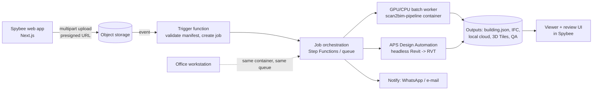

# Roadmap after the MVP

Each phase starts only when the previous one met its exit criteria. Dates depend on the pilot (M6).

| Phase | Goal | Exit criteria |
|---|---|---|
| 9. Hardening | 3–5 more buildings (shell / finished, residential / office); parameter profiles per building type; local regression suite on real clouds | Same KPIs on ≥ 3 new buildings without code changes |
| 10. ML segmentation | Clean site clutter before the geometric stages with OWN weights | Wall/column P/R +5 pts on cluttered buildings |
| 11. **Spybee platform integration** | Upload → automatic processing → review → download, inside Spybee | Ops team runs a project end-to-end without Claude/dev help |
| 12. Progress monitoring | Recurring scans vs design BIM (ACC) on active sites | Weekly report per site with near-zero human time |
| 13. LOD 300 + MEP | Client type catalogues, door/window families, assisted pipe/duct extraction | LOD 300 arch+struct in ≤ 5 working days |

## Phase 10 — ML segmentation (own weights)

- **Auto-labelling:** align each historical cloud with its hand-made BIM; each point inherits the class of the
  nearest element (distance threshold) → labelled clouds almost for free.
- **Synthetic data:** virtual scans (ray casting) of client design models in ACC — with explicit permission.
- **Model:** Pointcept (MIT) codebase with PTv3/LitePT-style backbones trained from scratch or from
  commercially licensed weights only. Track provenance (code licence, weights licence, data licence) per model.
- **Hardware:** a single 24–32 GB GPU is enough to start (or rented cloud GPUs for training).
- **Integration:** a new stage `segment` between `prep` and `levels`; geometry stays geometric.

## Phase 11 — Spybee platform integration (the "interface")

Goal: operations uploads the scan leader's deliverable in the Spybee web app and receives the RVT/IFC + QA,
then reviews in Revit; later a light review UI in the browser.

New repo **`scan2bim-service`** (TypeScript or Python): job API + infrastructure as code.

| Endpoint (sketch) | Purpose |
|---|---|
| `POST /v1/scan2bim/jobs` | Create a job from an uploaded manifest (project metadata + file keys) |
| `GET /v1/scan2bim/jobs/{id}` | Status, per-stage timings, warnings |
| `GET /v1/scan2bim/jobs/{id}/artifacts` | Signed URLs: building.json, model.ifc, model.rvt, qa.html, cloud_local.las |
| `POST /v1/scan2bim/jobs/{id}/corrections` | Upload corrections.json after review (feeds metrics + training) |

Design rules:
- The pipeline container is the **same** code as the CLI (`scan2bim run-all`) — no fork.
- Lambda-style functions only for glue (max ~15 min, no GPU); heavy work in batch containers.
- `scan2bim-revit` `ModelBuilder` packaged as an APS Design Automation app bundle (no UI code — already enforced).
- Tenant isolation, encryption at rest, retention policy, audit log; client consent for training use.
- Viewer: Potree / 3D Tiles for clouds, That Open Engine (web-ifc) or APS Viewer for models.

## Phase 12 — Progress monitoring

Same pipeline on recurring captures; compare against the design BIM (ACC) per element: built / not built /
deviating; slab flatness reports; weekly dashboard in Spybee. Highest recurring value for Spybee's platform.

## Phase 13 — LOD 300 and MEP

Map detected elements to client type catalogues (LLM-assisted mapping is acceptable; geometry never comes
from an LLM); door/window families; MEP straight runs (cylinder RANSAC) + assisted tools (e.g. EdgeWise) for the rest.
